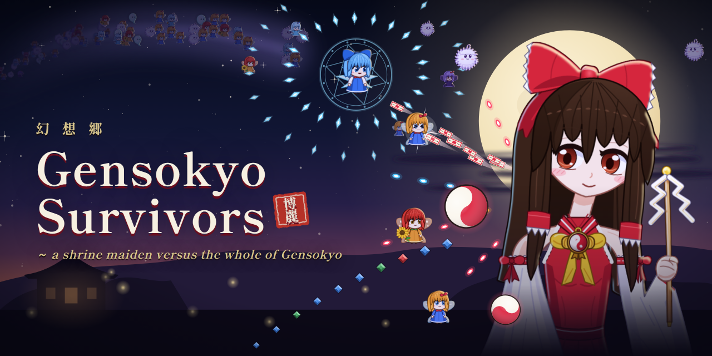
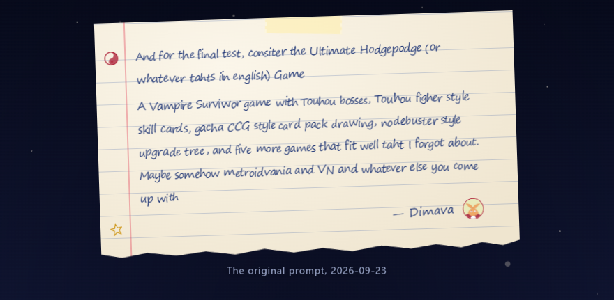
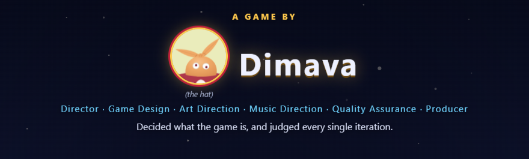
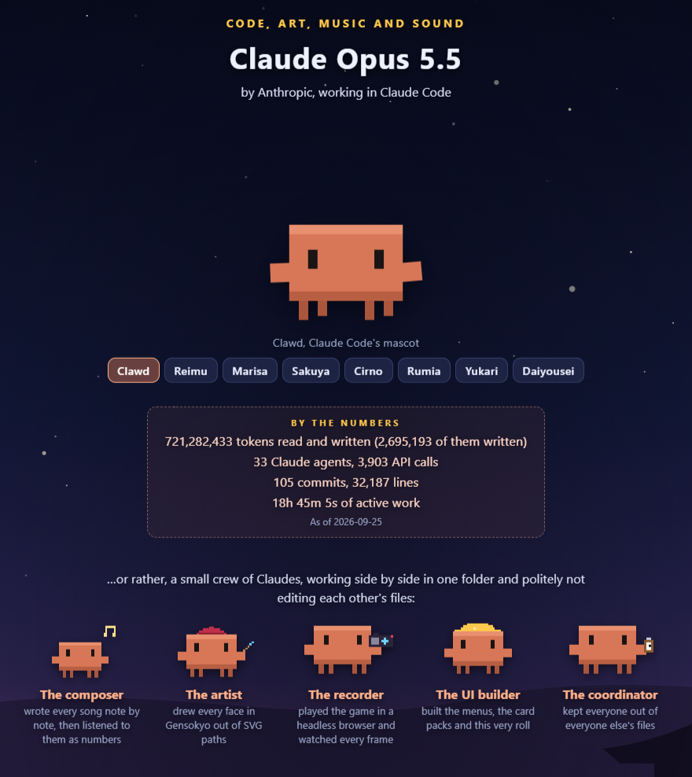
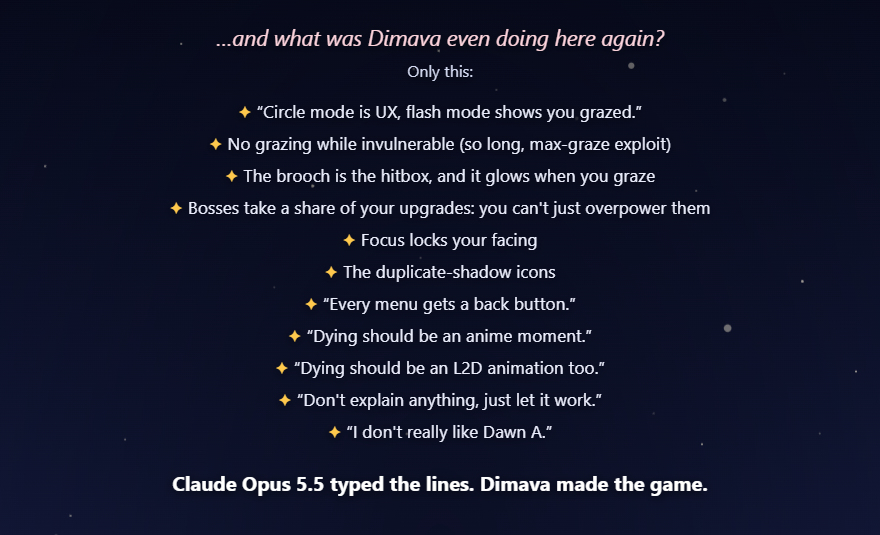
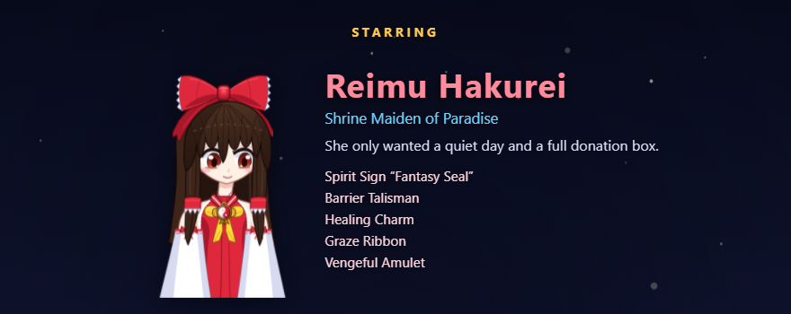
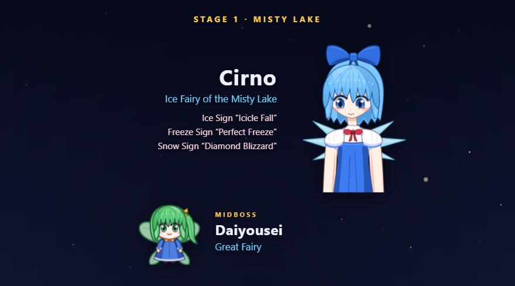

# Gensokyo Survivors

[](https://dimava.github.io/gensokyo-survivors/)

**Play in the browser: https://dimava.github.io/gensokyo-survivors/**

*A shrine maiden versus the whole of Gensokyo.*

A Touhou-flavoured bullet-hell survivors game. You are Reimu Hakurei. Fairies swarm the Misty Lake by the thousand, and every ice fairy with an ego is firing danmaku at you. Your weapons fire on their own; your job is to move, dodge and decide.

- **Survive the swarm.** Enemies pour in from every side. Collect their experience gems to level up, then pick a new weapon or passive, or upgrade one you have. Six weapons and ten passives stack into your build.
- **Graze to draw.** Skimming past bullets draws skill cards from your deck. Cards cost Spirit, which refills over time: Fantasy Seal blasts everything around you, Barrier erases bullets, Master Spark fires a beam. Hold Shift to focus and thread the gaps.
- **Beat the boss.** Every stage ends in a Touhou-style boss fight of three named spell cards, each with its own timer. Break them without getting hit to capture them. Cirno waits at the Misty Lake, Rumia in the Forest of Magic.
- **Grow between runs.** Spend the donations you earn on 19 shrine upgrades, or on card packs that add new skill cards to your deck or level up ones you own.

Every picture is drawn in code (Live2D-style rigs, no image files), and the original soundtrack plays on a synthesizer in code with a few recorded instruments (piano, drums, trumpet and strings from the public-domain VSCO 2 Community Edition).

**Controls:** WASD / arrows to move · Shift to focus · 1–4 to play a card · Esc to pause. Menus work with the keyboard or the mouse.

## Credits

A game by **Dimava**. Code, art, music and sound by **Claude Opus 5.5** (Anthropic) in Claude Code. These stills are from the credits roll in the game (Gallery → Credits).

| | |
|---|---|
|  |  |
|  |  |
|  |  |

---

## Run from source

The `master` branch contains the game source. The `dist` branch contains the
built game served by GitHub Pages.

Install [Bun](https://bun.sh/), then:

```sh
git clone --branch master https://github.com/Dimava/gensokyo-survivors.git
cd gensokyo-survivors
bun install --frozen-lockfile
bun run dev
```

Open the local URL printed by Vite (normally `http://localhost:5190`).

The matching gamebones v2 kernel is included in [`vendor/gamebones`](vendor/gamebones).
You do not need a separate gamebones checkout. Its source revision and pinned
dependencies are recorded in [`UPSTREAM.md`](vendor/gamebones/UPSTREAM.md).

```sh
bun test        # existing game tests, including replay and save/load checks
bun run check   # TypeScript and Vue type checks
bun run lint    # lint game source, tests and scripts
bun run build   # build into dist/
bun run preview # serve the production build locally
```

Gameplay art is generated in code; the README screenshots are included in
`docs/`. Build-time credit statistics use local development transcripts when
available; they are optional and require no credentials to build the game.

Gensokyo Survivors is an unofficial fan work of the Touhou Project. It is not affiliated with Team Shanghai Alice. Touhou Project characters and world © ZUN / Team Shanghai Alice.
